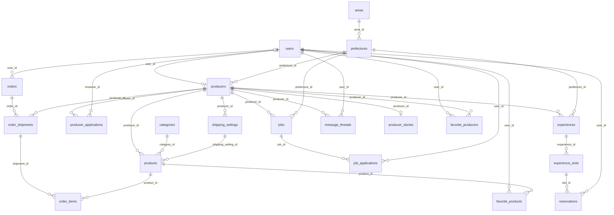
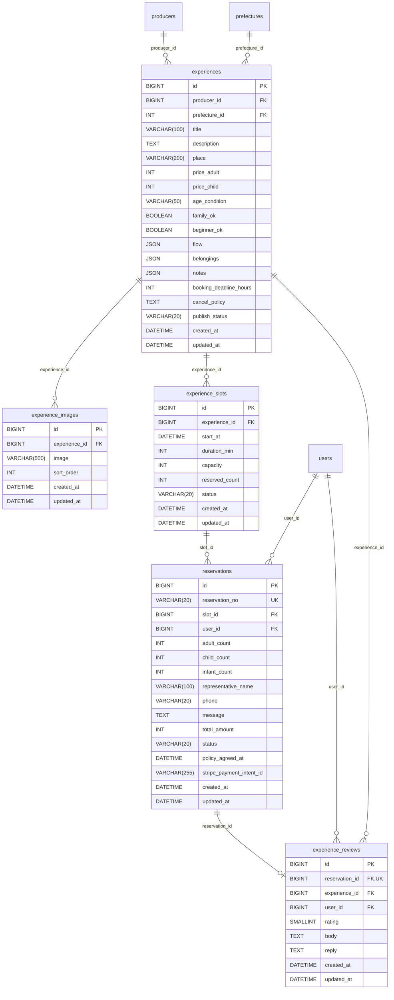
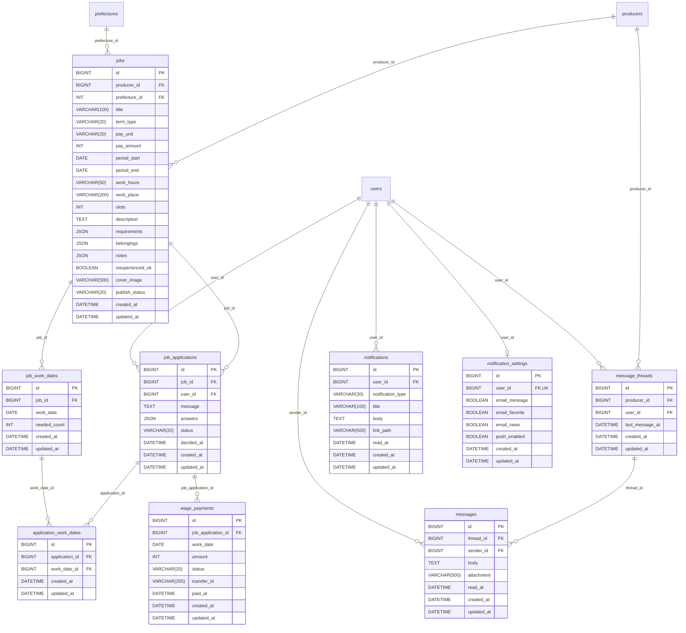
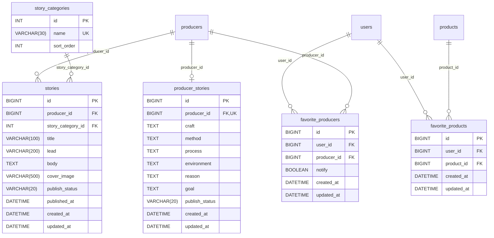
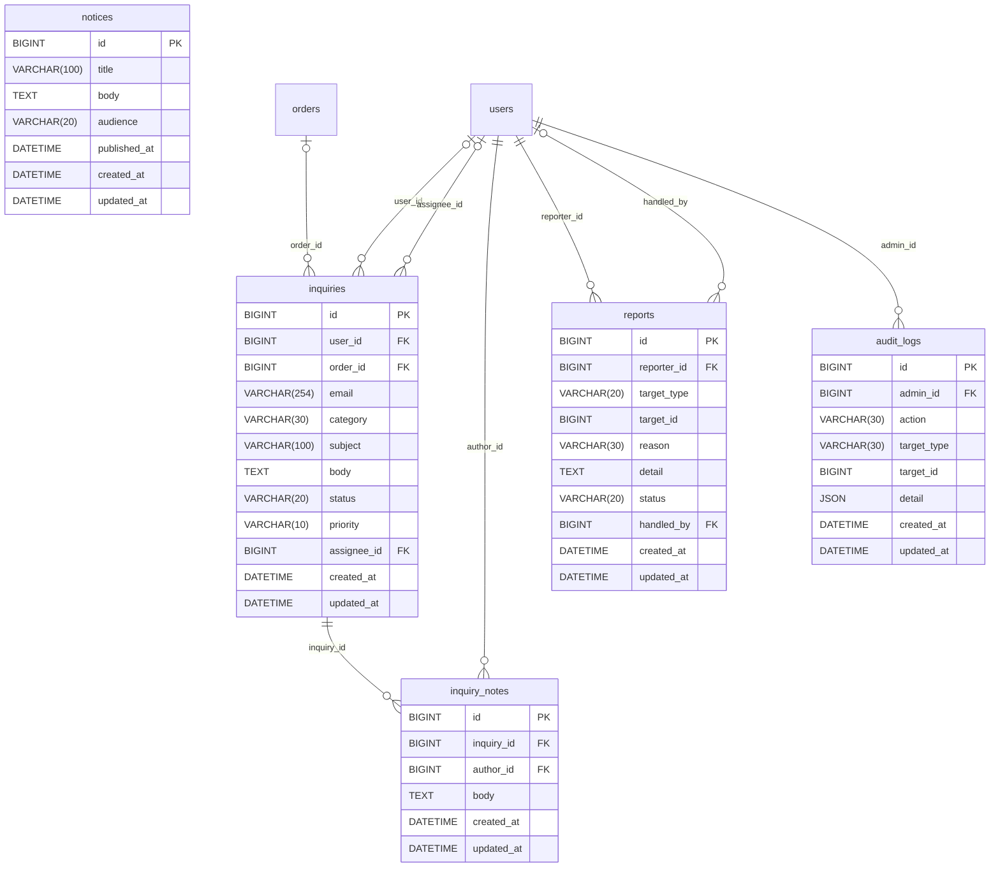

# つながるマルシェ ER図（第13版）

44テーブル（MVP 23 / 拡張 19 / Django標準 2）。Django + MySQL 前提。

第13版の変更（実装ステップ2〜16のマイグレーション 0006〜0012 を反映。実際のモデルと1列ずつ突き合わせ済み）：
- orders に stripe_checkout_session_id を追加（0007。決済を Stripe Checkout にしたため）
- experiences に booking_deadline_hours を追加（0008。申込の締め切り）
- cart_items に一意制約 (user_id, product_id)・(session_key, product_id) を追加（0006）
- notifications.notification_type に cancel_rejected・producer_review・new_application・application_withdrawn・new_review・review_reply・listing_suspended・listing_resumed を追加（0009〜0011）
- 権限グループ（管理者・CS・審査担当）の3行をマイグレーションで作る（0012。表の形は変わらない）
- application_work_dates の一意制約 (application_id, work_date_id) を記載（もとからあった制約の書き漏れ）
- 税率・割引率・評価の型を実際の型 SMALLINT に合わせた（TINYINT と書いていた）
- reports.reason の値（6種類）、audit_logs.action・target_type の値を記載
- 設計メモを実装に合わせて更新（決済は Stripe Checkout、未払い注文の取り消し、返金待ち、メール未確認でもできること など）

第12版の変更（実装ステップ1：認証で決定）：users に email_verified_at・prefecture_id・interests を追加、user_consents（規約への同意履歴）を追加、users.email は前後の空白を除き小文字で保存。

## 全体像



## A. アカウント・生産者

ログインする全員の users と、そこにぶら下がる生産者プロフィール、申請と審査。規約への同意履歴と住所マスタもここ。

```mermaid
erDiagram
  users {
    BIGINT id PK
    VARCHAR(254) email UK
    VARCHAR(128) password
    VARCHAR(50) last_name
    VARCHAR(50) first_name
    VARCHAR(20) phone
    DATE birth_date
    VARCHAR(500) profile_image
    DATETIME email_verified_at
    INT prefecture_id FK
    JSON interests
    BOOLEAN is_active
    BOOLEAN is_staff
    BOOLEAN is_superuser
    DATETIME last_login
    DATETIME date_joined
    DATETIME deleted_at
    DATETIME updated_at
  }
  user_consents {
    BIGINT id PK
    BIGINT user_id FK
    VARCHAR(20) document_type
    VARCHAR(30) version
    DATETIME agreed_at
    DATETIME created_at
    DATETIME updated_at
  }
  auth_group {
    INT id PK
    VARCHAR(150) name UK
  }
  users_groups {
    BIGINT id PK
    BIGINT user_id FK
    INT group_id FK
  }
  areas {
    INT id PK
    VARCHAR(20) name UK
    INT sort_order
  }
  prefectures {
    INT id PK
    INT area_id FK
    VARCHAR(10) name UK
  }
  addresses {
    BIGINT id PK
    BIGINT user_id FK
    VARCHAR(100) recipient_name
    VARCHAR(8) postal_code
    INT prefecture_id FK
    VARCHAR(50) city
    VARCHAR(100) address_line1
    VARCHAR(100) address_line2
    VARCHAR(20) phone
    BOOLEAN is_default
    DATETIME created_at
    DATETIME updated_at
  }
  producers {
    BIGINT id PK
    BIGINT user_id FK, UK
    VARCHAR(100) business_name
    VARCHAR(100) representative_name
    VARCHAR(20) genre
    INT prefecture_id FK
    VARCHAR(50) city
    VARCHAR(100) production_items
    TEXT intro
    SMALLINT career_start_year
    SMALLINT founded_year
    BOOLEAN accepts_experience
    BOOLEAN recruiting
    VARCHAR(500) profile_image
    VARCHAR(500) cover_image
    VARCHAR(20) approval_status
    DATETIME approved_at
    VARCHAR(20) publish_status
    DECIMAL(6,2) featured_score
    VARCHAR(255) stripe_account_id
    DATETIME created_at
    DATETIME updated_at
  }
  producer_images {
    BIGINT id PK
    BIGINT producer_id FK
    VARCHAR(500) image
    INT sort_order
    DATETIME created_at
    DATETIME updated_at
  }
  shipping_settings {
    BIGINT id PK
    BIGINT producer_id FK
    VARCHAR(20) temperature_zone
    INT shipping_fee
    INT free_shipping_threshold
    VARCHAR(50) lead_time_text
    DATETIME created_at
    DATETIME updated_at
  }
  producer_applications {
    BIGINT id PK
    BIGINT producer_id FK
    VARCHAR(20) status
    TEXT application_reason
    BIGINT reviewer_id FK
    TEXT review_comment
    DATETIME submitted_at
    DATETIME reviewed_at
    DATETIME created_at
    DATETIME updated_at
  }
  application_documents {
    BIGINT id PK
    BIGINT application_id FK
    VARCHAR(30) doc_type
    VARCHAR(500) file
    VARCHAR(20) check_status
    DATETIME created_at
    DATETIME updated_at
  }
  users ||--o{ user_consents : "user_id"
  prefectures |o--o{ users : "prefecture_id"
  users ||--o{ users_groups : "user_id"
  auth_group ||--o{ users_groups : "group_id"
  areas ||--o{ prefectures : "area_id"
  users ||--o{ addresses : "user_id"
  prefectures ||--o{ addresses : "prefecture_id"
  users ||--o| producers : "user_id"
  prefectures ||--o{ producers : "prefecture_id"
  producers ||--o{ producer_images : "producer_id"
  producers ||--o{ shipping_settings : "producer_id"
  producers ||--o{ producer_applications : "producer_id"
  users |o--o{ producer_applications : "reviewer_id"
  producer_applications ||--o{ application_documents : "application_id"
```

### users（ユーザー）— MVP

AbstractUser を継承し、username を外して email でログインする（USERNAME_FIELD = 'email'）。消費者・生産者・運営の全員がここに1行持つ。生産者かどうかは producers に行があるか、運営かどうかは is_staff で判定する。

| カラム名 | 型 | PK | FK | NOT NULL | UNIQUE | 説明 |
| --- | --- | --- | --- | --- | --- | --- |
| id | BIGINT | ○ | - | ○ | ○ | ID |
| email | VARCHAR(254) | - | - | ○ | ○ | メールアドレス。ログインIDとして使う。前後の空白を除き小文字で保存し、ログイン時も同じルールで探す（大文字・小文字を区別しない）。退会・削除では deleted_{id}@invalid に置き換える |
| password | VARCHAR(128) | - | - | ○ | - | ハッシュ化したパスワード（Django標準）。運営スタッフの追加直後は「使えない値」で、パスワード設定のリンクから本人が決める |
| last_name | VARCHAR(50) | - | - | ○ | - | 姓。新規登録の入力は1〜10文字 |
| first_name | VARCHAR(50) | - | - | ○ | - | 名。新規登録の入力は1〜10文字 |
| phone | VARCHAR(20) | - | - | - | - | 電話番号。ハイフンを除いた数字だけで保存。新規登録では必須（APIで検証）。体験予約・求人応募の連絡先 |
| birth_date | DATE | - | - | - | - | 生年月日。新規登録では必須（APIで検証。1900-01-01〜今日）。求人の年齢条件の確認用（生産者には年齢だけを見せる） |
| profile_image | VARCHAR(500) | - | - | - | - | 会員のプロフィール画像（S3のキー）。生産者の画像は producers.profile_image |
| email_verified_at | DATETIME | - | - | - | - | メールアドレスを確認した日時。未確認なら空。APIの emailVerified はここから判定する。パスワード再設定のリンクから来たときも確認済みにする |
| prefecture_id | INT | - | prefectures.id | - | - | 住まいの都道府県（任意） |
| interests | JSON | - | - | ○ | - | 興味のあること（vegetables / fruits / seafood / experiences / short_term_jobs / farming の配列、重複なし・最大6）。初期値は空の配列 |
| is_active | BOOLEAN | - | - | ○ | - | ログインできるか。利用停止・退会で False（Django標準）。False の人のセッションは Django が受け付けないので、どの端末もログアウトになる |
| is_staff | BOOLEAN | - | - | ○ | - | 運営スタッフか。運営管理画面に入れる（Django標準） |
| is_superuser | BOOLEAN | - | - | ○ | - | すべての権限を持つか（Django標準）。アプリでは使わない（権限は auth_group で決める） |
| last_login | DATETIME | - | - | - | - | 最終ログイン日時（Django標準・自動更新） |
| date_joined | DATETIME | - | - | ○ | - | 登録日時（Django標準） |
| deleted_at | DATETIME | - | - | - | - | 退会日時。利用停止と退会を見分ける |
| updated_at | DATETIME | - | - | ○ | - | 更新日時（作成時は created_at と同じ値） |

### user_consents（規約への同意履歴）— MVP

新規登録などで、どの版の利用規約・プライバシーポリシーに同意したかを1行ずつ残す。再同意しても上書きせず行を追加するので履歴が残る。規約の本文は DB に持たず、現行の版は settings（TERMS_VERSION・PRIVACY_POLICY_VERSION）に持つ。退会・削除は匿名化で行を残すため、user_id は物理削除しない（PROTECT）。インデックス (user_id, document_type)。

| カラム名 | 型 | PK | FK | NOT NULL | UNIQUE | 説明 |
| --- | --- | --- | --- | --- | --- | --- |
| id | BIGINT | ○ | - | ○ | ○ | ID |
| user_id | BIGINT | - | users.id | ○ | - | 同意した会員 |
| document_type | VARCHAR(20) | - | - | ○ | - | terms（利用規約）/ privacy_policy（プライバシーポリシー） |
| version | VARCHAR(30) | - | - | ○ | - | 同意した版（画面に表示した版。例：2026-10-01） |
| agreed_at | DATETIME | - | - | ○ | - | 同意日時 |
| created_at | DATETIME | - | - | ○ | - | 作成日時 |
| updated_at | DATETIME | - | - | ○ | - | 更新日時（作成時は created_at と同じ値） |

### auth_group（権限グループ）— Django標準

Django標準。表はマイグレーションで自動作成され、「管理者」「CS」「審査担当」の3行もマイグレーション（marche 0012）で作る。どの API をどのグループが使えるかはコード（api/common/permissions.py）で決める。最初の管理者は `python manage.py create_admin` で作り、2人目からは管理画面（POST /admin/admins）で追加する。

| カラム名 | 型 | PK | FK | NOT NULL | UNIQUE | 説明 |
| --- | --- | --- | --- | --- | --- | --- |
| id | INT | ○ | - | ○ | ○ | ID |
| name | VARCHAR(150) | - | - | ○ | ○ | 管理者（すべて）/ CS（注文・返金・ユーザー管理・問い合わせ・通報）/ 審査担当（生産者審査・掲載の管理） |

### users_groups（ユーザー×権限グループ）— Django標準

Django標準の中間テーブル。user_id + group_id でユニーク。1人に複数の役割を持たせられる。

| カラム名 | 型 | PK | FK | NOT NULL | UNIQUE | 説明 |
| --- | --- | --- | --- | --- | --- | --- |
| id | BIGINT | ○ | - | ○ | ○ | ID |
| user_id | BIGINT | - | users.id | ○ | - | 運営スタッフ |
| group_id | INT | - | auth_group.id | ○ | - | 権限グループ |

### areas（エリア）— MVP

マスタ（7行）。体験・求人の「エリアから探す」のタグ一覧。

| カラム名 | 型 | PK | FK | NOT NULL | UNIQUE | 説明 |
| --- | --- | --- | --- | --- | --- | --- |
| id | INT | ○ | - | ○ | ○ | ID |
| name | VARCHAR(20) | - | - | ○ | ○ | 北海道 / 東北 / 関東 / 中部 / 近畿 / 中国・四国 / 九州・沖縄 |
| sort_order | INT | - | - | ○ | - | 表示順。id は変えずに並びだけ変えられる |

### prefectures（都道府県）— MVP

マスタ（47行）。エリアはここから引くので、producers などに area_id は持たせない。

| カラム名 | 型 | PK | FK | NOT NULL | UNIQUE | 説明 |
| --- | --- | --- | --- | --- | --- | --- |
| id | INT | ○ | - | ○ | ○ | JISコード（01〜47） |
| area_id | INT | - | areas.id | ○ | - | 所属エリア |
| name | VARCHAR(10) | - | - | ○ | ○ | 都道府県名 |

### addresses（お届け先）— 拡張

会員の住所録。1人で複数件（自宅・実家・贈答先）持てる。注文時は値を orders にコピーするので、編集・削除しても過去の注文は変わらない。

| カラム名 | 型 | PK | FK | NOT NULL | UNIQUE | 説明 |
| --- | --- | --- | --- | --- | --- | --- |
| id | BIGINT | ○ | - | ○ | ○ | ID |
| user_id | BIGINT | - | users.id | ○ | - | 登録した会員 |
| recipient_name | VARCHAR(100) | - | - | ○ | - | 受取人名 |
| postal_code | VARCHAR(8) | - | - | ○ | - | 郵便番号 |
| prefecture_id | INT | - | prefectures.id | ○ | - | 都道府県。地域別送料（拡張）にも使う |
| city | VARCHAR(50) | - | - | ○ | - | 市区町村（郵便番号から自動入力） |
| address_line1 | VARCHAR(100) | - | - | ○ | - | 町域・番地 |
| address_line2 | VARCHAR(100) | - | - | - | - | 建物名・部屋番号 |
| phone | VARCHAR(20) | - | - | ○ | - | 受取人の電話番号 |
| is_default | BOOLEAN | - | - | ○ | - | いつも使うお届け先 |
| created_at | DATETIME | - | - | ○ | - | 作成日時 |
| updated_at | DATETIME | - | - | ○ | - | 更新日時（作成時は created_at と同じ値） |

### producers（生産者）— MVP

users にぶら下がる生産者プロフィール。バッジは列で持たず、career_start_year / approved_at / accepts_experience / recruiting から表示時に判定する。

| カラム名 | 型 | PK | FK | NOT NULL | UNIQUE | 説明 |
| --- | --- | --- | --- | --- | --- | --- |
| id | BIGINT | ○ | - | ○ | ○ | ID |
| user_id | BIGINT | - | users.id | ○ | ○ | ログインアカウント。1ユーザーにつき1生産者 |
| business_name | VARCHAR(100) | - | - | ○ | - | 事業者名（農園・漁協・牧場などの名前）。承認後は生産者が変えられない（問い合わせで対応） |
| representative_name | VARCHAR(100) | - | - | ○ | - | 代表者名。承認後は生産者が変えられない |
| genre | VARCHAR(20) | - | - | ○ | - | agriculture（農業）/ livestock（畜産）/ fishery（漁業）。承認後は生産者が変えられない |
| prefecture_id | INT | - | prefectures.id | ○ | - | 所在地の都道府県。エリア検索に使う |
| city | VARCHAR(50) | - | - | ○ | - | 市区町村。公開するのはここまで（番地は持たない） |
| production_items | VARCHAR(100) | - | - | ○ | - | 生産品目（例：りんご・ぶどう） |
| intro | TEXT | - | - | ○ | - | ひとこと紹介 |
| career_start_year | SMALLINT | - | - | - | - | 本人がこの仕事を始めた年。5年以内なら新規就業バッジ（表示は genre で「新規就農」「新規就漁」などに出し分け） |
| founded_year | SMALLINT | - | - | - | - | 事業の創業年（例：三代目の農園なら1962）。本人が始めた年は career_start_year。表示用 |
| accepts_experience | BOOLEAN | - | - | ○ | - | 体験受け入れ中バッジ |
| recruiting | BOOLEAN | - | - | ○ | - | 担い手募集中バッジ |
| profile_image | VARCHAR(500) | - | - | - | - | プロフィール画像（S3のキー） |
| cover_image | VARCHAR(500) | - | - | - | - | 農園のメイン画像（S3のキー） |
| approval_status | VARCHAR(20) | - | - | ○ | - | pending（審査待ち）/ approved / rejected / returned（差し戻し） |
| approved_at | DATETIME | - | - | - | - | 承認日時。新規参加バッジの判定に使う |
| publish_status | VARCHAR(20) | - | - | ○ | - | draft（下書き。承認直後）/ public（公開）/ private（非公開）/ suspended（運営による掲載停止）。生産者が変えられるのは public・private だけ。運営が掲載停止を解除すると private に戻る。利用停止・退会でも suspended になる |
| featured_score | DECIMAL(6,2) | - | - | ○ | - | 注目スコア。夜間バッチで更新（初期値0） |
| stripe_account_id | VARCHAR(255) | - | - | - | - | Stripe Connect の売上受取アカウント（拡張） |
| created_at | DATETIME | - | - | ○ | - | 作成日時 |
| updated_at | DATETIME | - | - | ○ | - | 更新日時（作成時は created_at と同じ値） |

### producer_images（農園画像）— MVP

生産者プロフィールの更新で、送られた配列で丸ごと置き換える（配列の順が sort_order。S3 のファイルは消さない）。最大10枚。

| カラム名 | 型 | PK | FK | NOT NULL | UNIQUE | 説明 |
| --- | --- | --- | --- | --- | --- | --- |
| id | BIGINT | ○ | - | ○ | ○ | ID |
| producer_id | BIGINT | - | producers.id | ○ | - | 生産者 |
| image | VARCHAR(500) | - | - | ○ | - | 画像（S3のキー） |
| sort_order | INT | - | - | ○ | - | 表示順 |
| created_at | DATETIME | - | - | ○ | - | 作成日時 |
| updated_at | DATETIME | - | - | ○ | - | 更新日時（作成時は created_at と同じ値） |

### shipping_settings（配送設定）— MVP

生産者×温度帯で1行。producer_id + temperature_zone でユニーク。

| カラム名 | 型 | PK | FK | NOT NULL | UNIQUE | 説明 |
| --- | --- | --- | --- | --- | --- | --- |
| id | BIGINT | ○ | - | ○ | ○ | ID |
| producer_id | BIGINT | - | producers.id | ○ | - | 生産者 |
| temperature_zone | VARCHAR(20) | - | - | ○ | - | normal（常温）/ chilled（冷蔵）/ frozen（冷凍） |
| shipping_fee | INT | - | - | ○ | - | 送料（円） |
| free_shipping_threshold | INT | - | - | - | - | この金額以上で送料無料（円）。同じ温度帯の箱の商品合計（割引後）で判定する。空なら送料無料にしない。送料無料は商品ごとではなくこのルールだけで決める |
| lead_time_text | VARCHAR(50) | - | - | ○ | - | 発送目安（例：2〜4日で発送） |
| created_at | DATETIME | - | - | ○ | - | 作成日時 |
| updated_at | DATETIME | - | - | ○ | - | 更新日時（作成時は created_at と同じ値） |

### producer_applications（生産者申請）— MVP

差し戻し後の再申請は新しい行を追加し、審査の履歴を残す。

| カラム名 | 型 | PK | FK | NOT NULL | UNIQUE | 説明 |
| --- | --- | --- | --- | --- | --- | --- |
| id | BIGINT | ○ | - | ○ | ○ | ID |
| producer_id | BIGINT | - | producers.id | ○ | - | 申請した生産者 |
| status | VARCHAR(20) | - | - | ○ | - | pending / approved / rejected / returned |
| application_reason | TEXT | - | - | ○ | - | 申請理由・自己紹介 |
| reviewer_id | BIGINT | - | users.id | - | - | 審査した運営スタッフ。審査前は空 |
| review_comment | TEXT | - | - | - | - | 却下・差し戻しの理由 |
| submitted_at | DATETIME | - | - | ○ | - | 申請日時 |
| reviewed_at | DATETIME | - | - | - | - | 審査日時 |
| created_at | DATETIME | - | - | ○ | - | 作成日時 |
| updated_at | DATETIME | - | - | ○ | - | 更新日時（作成時は created_at と同じ値） |

### application_documents（申請書類）— MVP

表はあるが、今の申請 API では書類を受け付けていない（未使用。書類の提出は拡張）。

| カラム名 | 型 | PK | FK | NOT NULL | UNIQUE | 説明 |
| --- | --- | --- | --- | --- | --- | --- |
| id | BIGINT | ○ | - | ○ | ○ | ID |
| application_id | BIGINT | - | producer_applications.id | ○ | - | 申請 |
| doc_type | VARCHAR(30) | - | - | ○ | - | 本人確認 / 営業許可 / 農地・漁業権 など |
| file | VARCHAR(500) | - | - | ○ | - | ファイル（S3のキー） |
| check_status | VARCHAR(20) | - | - | ○ | - | unchecked / ok / ng |
| created_at | DATETIME | - | - | ○ | - | 作成日時 |
| updated_at | DATETIME | - | - | ○ | - | 更新日時（作成時は created_at と同じ値） |

## B. 商品・注文

「買う」の流れ。ゲスト購入に対応し、1回の注文を生産者ごとの出荷に分ける。

```mermaid
erDiagram
  categories {
    INT id PK
    VARCHAR(30) name UK
    INT sort_order
  }
  products {
    BIGINT id PK
    BIGINT producer_id FK
    INT category_id FK
    BIGINT shipping_setting_id FK
    VARCHAR(100) name
    VARCHAR(50) volume
    TEXT description
    TEXT method
    INT price
    SMALLINT tax_rate
    SMALLINT discount_rate
    INT sale_price
    DECIMAL(6,2) popularity_score
    DECIMAL(2,1) rating_avg
    INT review_count
    INT stock
    BOOLEAN is_subscription
    BOOLEAN is_preorder
    BOOLEAN accepts_delivery_date
    VARCHAR(20) publish_status
    DATETIME created_at
    DATETIME updated_at
  }
  product_images {
    BIGINT id PK
    BIGINT product_id FK
    VARCHAR(500) image
    INT sort_order
    DATETIME created_at
    DATETIME updated_at
  }
  cart_items {
    BIGINT id PK
    BIGINT user_id FK
    VARCHAR(40) session_key
    BIGINT product_id FK
    INT quantity
    DATETIME created_at
    DATETIME updated_at
  }
  orders {
    BIGINT id PK
    VARCHAR(20) order_no UK
    BIGINT user_id FK
    VARCHAR(254) guest_email
    VARCHAR(100) guest_name
    VARCHAR(20) guest_phone
    VARCHAR(64) access_token_hash UK
    VARCHAR(100) ship_name
    VARCHAR(8) ship_postal_code
    VARCHAR(10) ship_prefecture
    VARCHAR(50) ship_city
    VARCHAR(100) ship_address_line1
    VARCHAR(100) ship_address_line2
    VARCHAR(20) ship_phone
    VARCHAR(20) payment_method
    INT items_total
    INT shipping_total
    INT grand_total
    INT tax_8_amount
    INT tax_10_amount
    VARCHAR(20) payment_status
    VARCHAR(255) stripe_payment_intent_id
    VARCHAR(255) stripe_checkout_session_id
    DATETIME ordered_at
    DATETIME created_at
    DATETIME updated_at
  }
  order_shipments {
    BIGINT id PK
    BIGINT order_id FK
    BIGINT producer_id FK
    VARCHAR(20) temperature_zone
    INT shipping_fee
    DATE desired_date
    VARCHAR(20) desired_time
    VARCHAR(20) status
    VARCHAR(30) tracking_no
    DATETIME shipped_at
    TEXT cancel_reason
    DATETIME canceled_at
    INT refunded_amount
    VARCHAR(255) stripe_refund_id
    DATETIME created_at
    DATETIME updated_at
  }
  order_items {
    BIGINT id PK
    BIGINT shipment_id FK
    BIGINT product_id FK
    VARCHAR(100) product_name
    INT unit_price
    SMALLINT discount_rate
    INT paid_unit_price
    INT quantity
    SMALLINT tax_rate
    INT subtotal
    DATETIME created_at
    DATETIME updated_at
  }
  product_reviews {
    BIGINT id PK
    BIGINT order_item_id FK, UK
    BIGINT product_id FK
    BIGINT user_id FK
    SMALLINT rating
    TEXT body
    TEXT reply
    DATETIME replied_at
    DATETIME created_at
    DATETIME updated_at
  }
  producers ||--o{ products : "producer_id"
  categories ||--o{ products : "category_id"
  shipping_settings ||--o{ products : "shipping_setting_id"
  products ||--o{ product_images : "product_id"
  users |o--o{ cart_items : "user_id"
  products ||--o{ cart_items : "product_id"
  users |o--o{ orders : "user_id"
  orders ||--o{ order_shipments : "order_id"
  producers ||--o{ order_shipments : "producer_id"
  order_shipments ||--o{ order_items : "shipment_id"
  products ||--o{ order_items : "product_id"
  order_items ||--o| product_reviews : "order_item_id"
  products ||--o{ product_reviews : "product_id"
  users ||--o{ product_reviews : "user_id"
```

### categories（商品カテゴリー）— MVP

| カラム名 | 型 | PK | FK | NOT NULL | UNIQUE | 説明 |
| --- | --- | --- | --- | --- | --- | --- |
| id | INT | ○ | - | ○ | ○ | ID |
| name | VARCHAR(30) | - | - | ○ | ○ | 野菜 / 果物 / 米 / お茶 / 魚介類 / 肉 など |
| sort_order | INT | - | - | ○ | - | 表示順 |

### products（商品）— MVP

一覧の並び順（新着・価格の安い順／高い順・人気・評価）に合わせ、複合インデックス (publish_status, created_at) / (publish_status, sale_price) / (publish_status, popularity_score) / (publish_status, rating_avg) を張る。どの並び順も最後に id DESC を付ける。注文履歴がなければ削除でき、あれば非公開にする。

| カラム名 | 型 | PK | FK | NOT NULL | UNIQUE | 説明 |
| --- | --- | --- | --- | --- | --- | --- |
| id | BIGINT | ○ | - | ○ | ○ | ID |
| producer_id | BIGINT | - | producers.id | ○ | - | 出品した生産者 |
| category_id | INT | - | categories.id | ○ | - | カテゴリー |
| shipping_setting_id | BIGINT | - | shipping_settings.id | ○ | - | 送るときの温度帯 |
| name | VARCHAR(100) | - | - | ○ | - | 商品名 |
| volume | VARCHAR(50) | - | - | ○ | - | 内容量（例：5kg 14〜18玉） |
| description | TEXT | - | - | ○ | - | 商品説明 |
| method | TEXT | - | - | - | - | この商品の生産方法（品種・栽培や加工の手順など）。空なら商品詳細に表示しない |
| price | INT | - | - | ○ | - | 定価・税込（円） |
| tax_rate | SMALLINT | - | - | ○ | - | 消費税率（%）。8＝食品（軽減税率）／10＝酒類・花・苗など。初期値8 |
| discount_rate | SMALLINT | - | - | - | - | 割引率（%）。1〜99（CHECK制約）。空は割引なし。期間は持たず、生産者が消せば割引なしに戻る |
| sale_price | INT | - | - | ○ | - | 割引後の価格・税込（円）。MySQLの生成列（STORED）：price * (100 - IFNULL(discount_rate, 0)) DIV 100（端数切り捨て）。DBが自動で計算するのでアプリからは書き込まない。価格順の並び替えに使う |
| popularity_score | DECIMAL(6,2) | - | - | ○ | - | 人気スコア。直近の販売数・お気に入り数などから夜間バッチで計算する（初期値0） |
| rating_avg | DECIMAL(2,1) | - | - | - | - | 平均評価（1.0〜5.0。小数第1位で四捨五入）。レビューがなければ空。レビューの登録・編集・削除のたびに、この商品の product_reviews を集計し直して保存する |
| review_count | INT | - | - | ○ | - | レビュー件数（初期値0）。rating_avg と同時に更新する |
| stock | INT | - | - | - | - | 在庫数。空なら在庫管理しない。注文時に減らし、キャンセル・未払いの取り消しで戻す。在庫更新APIだけで変える |
| is_subscription | BOOLEAN | - | - | ○ | - | 定期便 |
| is_preorder | BOOLEAN | - | - | ○ | - | 予約商品 |
| accepts_delivery_date | BOOLEAN | - | - | ○ | - | お届け日時の指定ができる |
| publish_status | VARCHAR(20) | - | - | ○ | - | draft（下書き）/ public（公開。画像1枚以上が必要）/ private（非公開）/ suspended（運営による掲載停止。生産者は内容を編集できるが、公開状態は変えられない） |
| created_at | DATETIME | - | - | ○ | - | 作成日時 |
| updated_at | DATETIME | - | - | ○ | - | 更新日時（作成時は created_at と同じ値） |

### product_images（商品画像）— MVP

| カラム名 | 型 | PK | FK | NOT NULL | UNIQUE | 説明 |
| --- | --- | --- | --- | --- | --- | --- |
| id | BIGINT | ○ | - | ○ | ○ | ID |
| product_id | BIGINT | - | products.id | ○ | - | 商品 |
| image | VARCHAR(500) | - | - | ○ | - | 画像（S3のキー） |
| sort_order | INT | - | - | ○ | - | 表示順。0がメイン |
| created_at | DATETIME | - | - | ○ | - | 作成日時 |
| updated_at | DATETIME | - | - | ○ | - | 更新日時（作成時は created_at と同じ値） |

### cart_items（カート）— 拡張

user_id か session_key のどちらか一方が必ず入る（CHECK制約）。(user_id, product_id) と (session_key, product_id) でそれぞれユニーク（同じ商品は1行にまとめ、数量で持つ）。ゲストがログイン・新規登録したら session_key の行を user_id に付け替える（同じ商品は数量を合算し上限10。api/services/cart.py の merge_guest_cart）。

| カラム名 | 型 | PK | FK | NOT NULL | UNIQUE | 説明 |
| --- | --- | --- | --- | --- | --- | --- |
| id | BIGINT | ○ | - | ○ | ○ | ID |
| user_id | BIGINT | - | users.id | - | - | 会員のカート。ゲストは空 |
| session_key | VARCHAR(40) | - | - | - | - | ゲストのカート（Djangoのセッションキー）。会員は空 |
| product_id | BIGINT | - | products.id | ○ | - | 商品 |
| quantity | INT | - | - | ○ | - | 数量（1〜10） |
| created_at | DATETIME | - | - | ○ | - | 作成日時 |
| updated_at | DATETIME | - | - | ○ | - | 更新日時（作成時は created_at と同じ値） |

### orders（注文）— 拡張

1回の会計 = 1注文。user_id か guest_email のどちらかが必ず入る（CHECK制約）。注文全体の情報（購入者・お届け先・決済・合計）だけを持ち、発送・キャンセル・返金は order_shipments で管理する。ゲスト注文をあとから会員に引き継ぐことはしない。お届け先は addresses と同じ分け方で値をコピーする。

| カラム名 | 型 | PK | FK | NOT NULL | UNIQUE | 説明 |
| --- | --- | --- | --- | --- | --- | --- |
| id | BIGINT | ○ | - | ○ | ○ | ID |
| order_no | VARCHAR(20) | - | - | ○ | ○ | 注文番号（TM-YYYYMMDD-NNNNNN。例：TM-20260921-000412） |
| user_id | BIGINT | - | users.id | - | - | 購入した会員。ゲスト購入は空 |
| guest_email | VARCHAR(254) | - | - | - | - | ゲストのメールアドレス。注文確認メールの送り先 |
| guest_name | VARCHAR(100) | - | - | - | - | ゲストの氏名 |
| guest_phone | VARCHAR(20) | - | - | - | - | ゲストの電話番号 |
| access_token_hash | VARCHAR(64) | - | - | ○ | ○ | 閲覧用トークンの SHA-256（16進数）。トークン自体は secrets.token_urlsafe(32) で作り、確認メールのURLに載せるだけでDBには保存しない。ゲストがログインなしで注文状況を見る・キャンセルするときは、URLのトークンをハッシュ化してこの列で検索する。支払いが確定したときに作り直して、確認メールで送る（古いリンクは無効になる） |
| ship_name | VARCHAR(100) | - | - | ○ | - | お届け先：受取人名（注文時点の写し） |
| ship_postal_code | VARCHAR(8) | - | - | ○ | - | お届け先：郵便番号 |
| ship_prefecture | VARCHAR(10) | - | - | ○ | - | お届け先：都道府県名（文字列で写す） |
| ship_city | VARCHAR(50) | - | - | ○ | - | お届け先：市区町村 |
| ship_address_line1 | VARCHAR(100) | - | - | ○ | - | お届け先：町域・番地 |
| ship_address_line2 | VARCHAR(100) | - | - | - | - | お届け先：建物名・部屋番号 |
| ship_phone | VARCHAR(20) | - | - | ○ | - | お届け先：電話番号 |
| payment_method | VARCHAR(20) | - | - | ○ | - | card / konbini |
| items_total | INT | - | - | ○ | - | 商品小計（割引後・税込・円）。注文時点の値で、キャンセルされても書き換えない |
| shipping_total | INT | - | - | ○ | - | 送料合計（order_shipments.shipping_fee の合計・円） |
| grand_total | INT | - | - | ○ | - | 合計・税込（円） |
| tax_8_amount | INT | - | - | ○ | - | 8%対象分の消費税額（円） |
| tax_10_amount | INT | - | - | ○ | - | 10%対象分の消費税額（円）。送料を含む |
| payment_status | VARCHAR(20) | - | - | ○ | - | pending（支払い待ち）/ paid（支払い済み）/ failed（決済失敗・期限切れ） |
| stripe_payment_intent_id | VARCHAR(255) | - | - | - | - | Stripe の決済ID（PaymentIntent）。支払いが終わったときに Webhook で記録し、返金に使う |
| stripe_checkout_session_id | VARCHAR(255) | - | - | - | - | Stripe Checkout のセッションID。注文時に作った支払い画面のID。未払いの取り消しで画面を閉じる（expire）のに使う |
| ordered_at | DATETIME | - | - | ○ | - | 注文日時 |
| created_at | DATETIME | - | - | ○ | - | 作成日時 |
| updated_at | DATETIME | - | - | ○ | - | 更新日時（作成時は created_at と同じ値） |

### order_shipments（発送（生産者×温度帯））— 拡張

1注文を「生産者×温度帯」の箱に分ける（order_id + producer_id + temperature_zone でユニーク）。送料は箱ごとにかかる。キャンセルは生産者単位で受け付け、その生産者の箱をまとめて cancel_requested にして、承認されたら箱ごとに返金する。生産者の注文管理はこの単位で見る。

| カラム名 | 型 | PK | FK | NOT NULL | UNIQUE | 説明 |
| --- | --- | --- | --- | --- | --- | --- |
| id | BIGINT | ○ | - | ○ | ○ | ID |
| order_id | BIGINT | - | orders.id | ○ | - | 注文 |
| producer_id | BIGINT | - | producers.id | ○ | - | 発送する生産者 |
| temperature_zone | VARCHAR(20) | - | - | ○ | - | normal（常温）/ chilled（冷蔵）/ frozen（冷凍）。温度帯が違えば別の箱で送る |
| shipping_fee | INT | - | - | ○ | - | この箱の送料（円・注文時点）。shipping_settings の送料を写す。商品の合計が free_shipping_threshold 以上なら0 |
| desired_date | DATE | - | - | - | - | お届け希望日 |
| desired_time | VARCHAR(20) | - | - | - | - | お届け希望時間帯 |
| status | VARCHAR(20) | - | - | ○ | - | unshipped（未発送）/ shipped（発送済み）/ delivered（配達完了。発送7日後に夜間バッチで付ける）/ cancel_requested（キャンセル申請中）/ canceled（キャンセル済み）。生産者がキャンセル申請を断ると unshipped に戻る |
| tracking_no | VARCHAR(30) | - | - | - | - | 送り状番号（任意） |
| shipped_at | DATETIME | - | - | - | - | 発送日時。売上はこの日時の月で数える |
| cancel_reason | TEXT | - | - | - | - | キャンセル申請の理由 |
| canceled_at | DATETIME | - | - | - | - | キャンセルが確定した日時 |
| refunded_amount | INT | - | - | - | - | 返金額（円）。この箱の明細の subtotal の合計＋shipping_fee。返金するまでは空（canceled でここが空なら「返金待ち」） |
| stripe_refund_id | VARCHAR(255) | - | - | - | - | Stripe の返金ID（箱ごとに部分返金する）。運営が手作業で返金したときは空 |
| created_at | DATETIME | - | - | ○ | - | 作成日時 |
| updated_at | DATETIME | - | - | ○ | - | 更新日時（作成時は created_at と同じ値） |

### order_items（注文明細）— 拡張

注文時点の価格と割引率を写して持つ。あとで商品の割引率や価格が変わっても、注文金額と返金額は変わらない。

| カラム名 | 型 | PK | FK | NOT NULL | UNIQUE | 説明 |
| --- | --- | --- | --- | --- | --- | --- |
| id | BIGINT | ○ | - | ○ | ○ | ID |
| shipment_id | BIGINT | - | order_shipments.id | ○ | - | 発送（箱） |
| product_id | BIGINT | - | products.id | ○ | - | 商品 |
| product_name | VARCHAR(100) | - | - | ○ | - | 注文時点の商品名 |
| unit_price | INT | - | - | ○ | - | 注文時点の定価・税込（円） |
| discount_rate | SMALLINT | - | - | - | - | 注文時点の割引率（%）。1〜99（CHECK制約）。空は割引なし |
| paid_unit_price | INT | - | - | ○ | - | 割引後の単価・税込（円・端数切り捨て） |
| quantity | INT | - | - | ○ | - | 数量 |
| tax_rate | SMALLINT | - | - | ○ | - | 注文時点の消費税率（%） |
| subtotal | INT | - | - | ○ | - | 小計＝paid_unit_price × quantity（税込・円） |
| created_at | DATETIME | - | - | ○ | - | 作成日時 |
| updated_at | DATETIME | - | - | ○ | - | 更新日時（作成時は created_at と同じ値） |

### product_reviews（商品レビュー）— 拡張

登録・編集・削除のたびに、同じトランザクションで products.rating_avg / review_count をこの商品の分だけ集計し直す。集計用に複合インデックス (product_id, rating) を張る。書けるのは、会員の支払い済みの注文で、箱が発送済み（shipped・delivered）になった明細だけ。

| カラム名 | 型 | PK | FK | NOT NULL | UNIQUE | 説明 |
| --- | --- | --- | --- | --- | --- | --- |
| id | BIGINT | ○ | - | ○ | ○ | ID |
| order_item_id | BIGINT | - | order_items.id | ○ | ○ | 購入した明細。1明細につき1件 |
| product_id | BIGINT | - | products.id | ○ | - | 商品（集計用） |
| user_id | BIGINT | - | users.id | ○ | - | 書いた会員。レビューは会員のみ。投稿者名は first_name を表示 |
| rating | SMALLINT | - | - | ○ | - | 評価（1〜5） |
| body | TEXT | - | - | - | - | 本文（1,000文字まで） |
| reply | TEXT | - | - | - | - | 生産者の返信（1,000文字まで。上書き・空で削除） |
| replied_at | DATETIME | - | - | - | - | 返信日時 |
| created_at | DATETIME | - | - | ○ | - | 作成日時 |
| updated_at | DATETIME | - | - | ○ | - | 更新日時（作成時は created_at と同じ値） |

## C. 体験

体験プログラムと開催日程、予約（ログイン必須）。



### experiences（体験プログラム）— MVP

流れ・持ち物・注意事項は検索に使わないので JSON にまとめた。メイン画像は experience_images の sort_order = 0（商品と同じ扱い）。エリアは prefecture_id → prefectures → areas でたどる。予約履歴がなければ削除でき、あれば非公開にする。料金を変えても、すでに入っている予約の金額は変えない。

| カラム名 | 型 | PK | FK | NOT NULL | UNIQUE | 説明 |
| --- | --- | --- | --- | --- | --- | --- |
| id | BIGINT | ○ | - | ○ | ○ | ID |
| producer_id | BIGINT | - | producers.id | ○ | - | 主催する生産者 |
| prefecture_id | INT | - | prefectures.id | ○ | - | 開催地の都道府県。エリア検索に使う。登録時は生産者の都道府県を初期値にする |
| title | VARCHAR(100) | - | - | ○ | - | タイトル |
| description | TEXT | - | - | ○ | - | 体験内容 |
| place | VARCHAR(200) | - | - | ○ | - | 開催場所・集合場所（市区町村以下の詳しい場所） |
| price_adult | INT | - | - | ○ | - | 大人1名の料金（円） |
| price_child | INT | - | - | - | - | 子ども1名の料金（円） |
| age_condition | VARCHAR(50) | - | - | - | - | 年齢条件（例：小学生以上） |
| family_ok | BOOLEAN | - | - | ○ | - | 親子で参加できる |
| beginner_ok | BOOLEAN | - | - | ○ | - | 初心者歓迎 |
| flow | JSON | - | - | - | - | 当日の流れ [{time, text}] |
| belongings | JSON | - | - | - | - | 持ち物 |
| notes | JSON | - | - | - | - | 注意事項 |
| booking_deadline_hours | INT | - | - | ○ | - | 申込の締め切り（開催の何時間前まで。0〜168、初期値24）。利用者のキャンセルも同じ締め切りまで |
| cancel_policy | TEXT | - | - | ○ | - | キャンセルポリシー |
| publish_status | VARCHAR(20) | - | - | ○ | - | draft（下書き）/ public（公開。画像1枚以上が必要）/ private（非公開）/ suspended（運営による掲載停止） |
| created_at | DATETIME | - | - | ○ | - | 作成日時 |
| updated_at | DATETIME | - | - | ○ | - | 更新日時（作成時は created_at と同じ値） |

### experience_images（体験画像）— MVP

| カラム名 | 型 | PK | FK | NOT NULL | UNIQUE | 説明 |
| --- | --- | --- | --- | --- | --- | --- |
| id | BIGINT | ○ | - | ○ | ○ | ID |
| experience_id | BIGINT | - | experiences.id | ○ | - | 体験 |
| image | VARCHAR(500) | - | - | ○ | - | 画像（S3のキー） |
| sort_order | INT | - | - | ○ | - | 表示順 |
| created_at | DATETIME | - | - | ○ | - | 作成日時 |
| updated_at | DATETIME | - | - | ○ | - | 更新日時（作成時は created_at と同じ値） |

### experience_slots（開催日程）— MVP

日程は1件ずつ登録する。予約がある日程は日時・所要時間を変えられない（定員は予約済み人数以上なら変えられる）。削除は予約がない日程だけで、予約がある日程は「中止」（canceled にして予約を全キャンセルし、予約者に知らせる）。過去の日程は登録・変更・削除できない。

| カラム名 | 型 | PK | FK | NOT NULL | UNIQUE | 説明 |
| --- | --- | --- | --- | --- | --- | --- |
| id | BIGINT | ○ | - | ○ | ○ | ID |
| experience_id | BIGINT | - | experiences.id | ○ | - | 体験 |
| start_at | DATETIME | - | - | ○ | - | 開催日時 |
| duration_min | INT | - | - | ○ | - | 所要時間（分） |
| capacity | INT | - | - | ○ | - | 定員（未就学児も含めて数える） |
| reserved_count | INT | - | - | ○ | - | 予約済み人数（大人＋子ども＋未就学児） |
| status | VARCHAR(20) | - | - | ○ | - | open（受付中）/ closed（受付の一時停止）/ canceled（中止） |
| created_at | DATETIME | - | - | ○ | - | 作成日時 |
| updated_at | DATETIME | - | - | ○ | - | 更新日時（作成時は created_at と同じ値） |

### reservations（体験予約）— MVP

申込の時点で予約が確定する（confirmed）。支払いは当日に現地で行う（オンライン決済は拡張）。

| カラム名 | 型 | PK | FK | NOT NULL | UNIQUE | 説明 |
| --- | --- | --- | --- | --- | --- | --- |
| id | BIGINT | ○ | - | ○ | ○ | ID |
| reservation_no | VARCHAR(20) | - | - | ○ | ○ | 予約番号（RV-…） |
| slot_id | BIGINT | - | experience_slots.id | ○ | - | 開催日程 |
| user_id | BIGINT | - | users.id | ○ | - | 予約した会員。ログイン必須 |
| adult_count | INT | - | - | ○ | - | 大人の人数 |
| child_count | INT | - | - | ○ | - | 子どもの人数 |
| infant_count | INT | - | - | ○ | - | 未就学児の人数（無料） |
| representative_name | VARCHAR(100) | - | - | ○ | - | 代表者氏名 |
| phone | VARCHAR(20) | - | - | ○ | - | 当日の連絡先 |
| message | TEXT | - | - | - | - | 生産者へのメッセージ |
| total_amount | INT | - | - | ○ | - | 合計金額（円。申込時点の料金で計算し、あとで料金が変わっても変えない） |
| status | VARCHAR(20) | - | - | ○ | - | confirmed（予約確定）/ canceled（キャンセル）/ attended（参加済み。開催日の翌日以降に夜間バッチで付ける）。applied はオンライン決済（拡張）用で、今は使わない |
| policy_agreed_at | DATETIME | - | - | ○ | - | キャンセルポリシーに同意した日時 |
| stripe_payment_intent_id | VARCHAR(255) | - | - | - | - | オンライン決済（拡張） |
| created_at | DATETIME | - | - | ○ | - | 作成日時 |
| updated_at | DATETIME | - | - | ○ | - | 更新日時（作成時は created_at と同じ値） |

### experience_reviews（体験レビュー）— 拡張

| カラム名 | 型 | PK | FK | NOT NULL | UNIQUE | 説明 |
| --- | --- | --- | --- | --- | --- | --- |
| id | BIGINT | ○ | - | ○ | ○ | ID |
| reservation_id | BIGINT | - | reservations.id | ○ | ○ | 参加した予約。1予約につき1件 |
| experience_id | BIGINT | - | experiences.id | ○ | - | 体験（集計用） |
| user_id | BIGINT | - | users.id | ○ | - | 書いた会員 |
| rating | SMALLINT | - | - | ○ | - | 評価（1〜5） |
| body | TEXT | - | - | - | - | 本文 |
| reply | TEXT | - | - | - | - | 生産者の返信 |
| created_at | DATETIME | - | - | ○ | - | 作成日時 |
| updated_at | DATETIME | - | - | ○ | - | 更新日時（作成時は created_at と同じ値） |

## D. 求人・チャット・通知

単発・短期・長期の募集、応募（ログイン必須）、事業者とのチャット、給与支払い。個人宛ての通知と通知設定。



### jobs（求人）— MVP

エリアは prefecture_id → prefectures → areas でたどる（勤務地が生産者の所在地と違っても正しく検索できる）。ジャンルは producers.genre を使う。応募履歴がなければ削除でき、あれば非公開にする。

| カラム名 | 型 | PK | FK | NOT NULL | UNIQUE | 説明 |
| --- | --- | --- | --- | --- | --- | --- |
| id | BIGINT | ○ | - | ○ | ○ | ID |
| producer_id | BIGINT | - | producers.id | ○ | - | 募集する生産者 |
| prefecture_id | INT | - | prefectures.id | ○ | - | 勤務地の都道府県。エリア検索に使う。登録時は生産者の都道府県を初期値にする |
| title | VARCHAR(100) | - | - | ○ | - | タイトル |
| term_type | VARCHAR(20) | - | - | ○ | - | one_day（単発）/ short（短期）/ long（長期） |
| pay_unit | VARCHAR(20) | - | - | ○ | - | hourly（時給）/ daily（日給）/ monthly（月給） |
| pay_amount | INT | - | - | ○ | - | 報酬額（円） |
| period_start | DATE | - | - | - | - | 募集期間の開始（空なら制限なし）。期間外は一覧に出さず、応募もできない |
| period_end | DATE | - | - | - | - | 募集期間の終了（空なら制限なし） |
| work_hours | VARCHAR(50) | - | - | ○ | - | 勤務時間（例：8:00〜15:00） |
| work_place | VARCHAR(200) | - | - | ○ | - | 勤務地（市区町村以下の詳しい場所） |
| slots | INT | - | - | ○ | - | 募集人数。採用済み（hired・completed）がこの人数に達したら応募を受け付けない（生産者は超えても採用できる） |
| description | TEXT | - | - | ○ | - | 仕事内容 |
| requirements | JSON | - | - | - | - | 応募条件 |
| belongings | JSON | - | - | - | - | 持ち物 |
| notes | JSON | - | - | - | - | 注意事項 |
| inexperienced_ok | BOOLEAN | - | - | ○ | - | 未経験歓迎 |
| cover_image | VARCHAR(500) | - | - | - | - | メイン画像（S3のキー。公開に画像は不要） |
| publish_status | VARCHAR(20) | - | - | ○ | - | draft（下書き）/ public（公開。単発・短期は今日以降の勤務日が1日以上必要）/ private（非公開）/ suspended（運営による掲載停止。生産者は公開状態を変えられない） |
| created_at | DATETIME | - | - | ○ | - | 作成日時 |
| updated_at | DATETIME | - | - | ○ | - | 更新日時（作成時は created_at と同じ値） |

### job_work_dates（勤務日）— MVP

応募画面の「勤務希望日」の選択肢。長期求人では作らない。求人の登録・更新で配列ごと送る（希望者がいる勤務日は削除できない）。

| カラム名 | 型 | PK | FK | NOT NULL | UNIQUE | 説明 |
| --- | --- | --- | --- | --- | --- | --- |
| id | BIGINT | ○ | - | ○ | ○ | ID |
| job_id | BIGINT | - | jobs.id | ○ | - | 求人 |
| work_date | DATE | - | - | ○ | - | 勤務日 |
| needed_count | INT | - | - | ○ | - | その日の募集人数。その日を希望して採用された人数がこれに達したら、その日は選べない |
| created_at | DATETIME | - | - | ○ | - | 作成日時 |
| updated_at | DATETIME | - | - | ○ | - | 更新日時（作成時は created_at と同じ値） |

### job_applications（求人応募）— MVP

job_id + user_id でユニーク（同じ求人への二重応募・再応募を防ぐ。取り下げ・不採用のあとも応募し直せない）。最近動きがあった順は updated_at で並べる。すべての状態の履歴が必要になったら、履歴テーブルを別に作る（拡張）。

| カラム名 | 型 | PK | FK | NOT NULL | UNIQUE | 説明 |
| --- | --- | --- | --- | --- | --- | --- |
| id | BIGINT | ○ | - | ○ | ○ | ID |
| job_id | BIGINT | - | jobs.id | ○ | - | 求人 |
| user_id | BIGINT | - | users.id | ○ | - | 応募した会員。ログイン必須 |
| message | TEXT | - | - | - | - | ひとことメッセージ |
| answers | JSON | - | - | - | - | あてはまるもの（任意のチェック項目）。今は空の配列 |
| status | VARCHAR(20) | - | - | ○ | - | applied（応募済み）/ screening（選考中）/ hired（採用）/ rejected（不採用）/ withdrawn（応募者が取り下げ。applied・screening のときだけ）/ completed（勤務完了。単発・短期は夜間バッチ、長期は生産者が付ける）。hired・rejected は戻せない |
| decided_at | DATETIME | - | - | - | - | 採用・不採用を決めた日時。決める前は空 |
| created_at | DATETIME | - | - | ○ | - | 応募日時 |
| updated_at | DATETIME | - | - | ○ | - | 更新日時（作成時は created_at と同じ値） |

### application_work_dates（応募の希望日）— MVP

application_id + work_date_id でユニーク。

| カラム名 | 型 | PK | FK | NOT NULL | UNIQUE | 説明 |
| --- | --- | --- | --- | --- | --- | --- |
| id | BIGINT | ○ | - | ○ | ○ | ID |
| application_id | BIGINT | - | job_applications.id | ○ | - | 応募 |
| work_date_id | BIGINT | - | job_work_dates.id | ○ | - | 希望した勤務日 |
| created_at | DATETIME | - | - | ○ | - | 作成日時 |
| updated_at | DATETIME | - | - | ○ | - | 更新日時（作成時は created_at と同じ値） |

### message_threads（メッセージスレッド）— 拡張

生産者と会員のやり取り1件分。producer_id + user_id でユニーク。始められるのは会員だけ。応募前の「事業者に質問する」も同じスレッドを使う。どの応募の話かは、スレッドの画面にこの会員の応募一覧（job_applications を JOIN）を並べて見せる。画面上の呼び方は「チャット」。API は未実装（後回し）。

| カラム名 | 型 | PK | FK | NOT NULL | UNIQUE | 説明 |
| --- | --- | --- | --- | --- | --- | --- |
| id | BIGINT | ○ | - | ○ | ○ | ID |
| producer_id | BIGINT | - | producers.id | ○ | - | 生産者 |
| user_id | BIGINT | - | users.id | ○ | - | 相手の会員 |
| last_message_at | DATETIME | - | - | ○ | - | 最後のメッセージ日時。一覧の並び順。メッセージ送信時に一緒に更新 |
| created_at | DATETIME | - | - | ○ | - | 作成日時 |
| updated_at | DATETIME | - | - | ○ | - | 更新日時（作成時は created_at と同じ値） |

### messages（メッセージ）— 拡張

リアルタイム通信は使わないメール型のやり取り。送信時に、相手がこのスレッドに未読（read_at が空）のメッセージを持っていなければ「新しいメッセージが届きました」と通知メールを1通送る（相手の notification_settings.email_message がオンのとき）。本文はサイトのチャット画面で読む。新着メッセージは notifications に入れず、未読件数は messages の read_at から数える。一覧を取得したときに既読にする。

| カラム名 | 型 | PK | FK | NOT NULL | UNIQUE | 説明 |
| --- | --- | --- | --- | --- | --- | --- |
| id | BIGINT | ○ | - | ○ | ○ | ID |
| thread_id | BIGINT | - | message_threads.id | ○ | - | スレッド |
| sender_id | BIGINT | - | users.id | ○ | - | 送信者 |
| body | TEXT | - | - | ○ | - | 本文 |
| attachment | VARCHAR(500) | - | - | - | - | 添付画像（S3のキー。画像だけ） |
| read_at | DATETIME | - | - | - | - | 相手が読んだ日時 |
| created_at | DATETIME | - | - | ○ | - | 作成日時 |
| updated_at | DATETIME | - | - | ○ | - | 更新日時（作成時は created_at と同じ値） |

### notifications（通知）— 拡張

個人宛てのサイト内通知。注文・発送・キャンセル・応募・予約・レビュー・掲載停止などの各処理の中で、メール送信と同時に登録する（設定で止められない。レビューへの返信だけはメールなし）。新着メッセージは入れない。インデックスは (user_id, created_at)（一覧を新しい順に取る）と (user_id, read_at)（未読件数を数える）。link_path は画面のパスなので、画面のURL構成を変えると古い通知のリンクが切れる点に注意。

| カラム名 | 型 | PK | FK | NOT NULL | UNIQUE | 説明 |
| --- | --- | --- | --- | --- | --- | --- |
| id | BIGINT | ○ | - | ○ | ○ | ID |
| user_id | BIGINT | - | users.id | ○ | - | 通知を受け取る会員（生産者も含む）。ゲストには作らない |
| notification_type | VARCHAR(30) | - | - | ○ | - | new_order（新規注文）/ shipped（発送）/ cancel_requested（キャンセル申請）/ canceled（キャンセル確定・返金）/ cancel_rejected（キャンセル申請のお断り）/ producer_review（生産者申請の審査結果）/ new_application（新しい応募）/ application_withdrawn（応募の取り下げ）/ application_result（応募結果）/ new_review（新しいレビュー）/ review_reply（レビューへの返信）/ reservation（体験予約）/ listing_suspended（掲載停止）/ listing_resumed（掲載停止の解除） |
| title | VARCHAR(100) | - | - | ○ | - | タイトル |
| body | TEXT | - | - | - | - | 本文 |
| link_path | VARCHAR(500) | - | - | - | - | 押したときに開く画面のパス（例：/dashboard/orders/123、/mypage/orders/45） |
| read_at | DATETIME | - | - | - | - | 既読日時。未読なら空 |
| created_at | DATETIME | - | - | ○ | - | 作成日時 |
| updated_at | DATETIME | - | - | ○ | - | 更新日時（作成時は created_at と同じ値） |

### notification_settings（通知設定）— 拡張

設定で止められるのは、届かなくても取引に困らないメールだけ。注文確認・発送・キャンセル確定・返金・応募結果・予約確定のメールと、サイト内の通知（notifications）は設定に関係なく必ず送る。会員登録（POST /users）と同じトランザクションで1行作る。

| カラム名 | 型 | PK | FK | NOT NULL | UNIQUE | 説明 |
| --- | --- | --- | --- | --- | --- | --- |
| id | BIGINT | ○ | - | ○ | ○ | ID |
| user_id | BIGINT | - | users.id | ○ | ○ | 会員。1人につき1行（会員登録時に作る） |
| email_message | BOOLEAN | - | - | ○ | - | 新着メッセージをメールで受け取る（初期値 True） |
| email_favorite | BOOLEAN | - | - | ○ | - | お気に入り生産者の新着をメールで受け取る（初期値 True）。favorite_producers.notify と両方オンのときだけ送る |
| email_news | BOOLEAN | - | - | ○ | - | 運営からのお知らせをメールで受け取る（初期値 True） |
| push_enabled | BOOLEAN | - | - | ○ | - | Push 通知を受け取る（初期値 False）。Push の送信と端末の登録は拡張 |
| created_at | DATETIME | - | - | ○ | - | 作成日時 |
| updated_at | DATETIME | - | - | ○ | - | 更新日時（作成時は created_at と同じ値） |

### wage_payments（給与支払い）— 拡張

| カラム名 | 型 | PK | FK | NOT NULL | UNIQUE | 説明 |
| --- | --- | --- | --- | --- | --- | --- |
| id | BIGINT | ○ | - | ○ | ○ | ID |
| job_application_id | BIGINT | - | job_applications.id | ○ | - | 応募（採用済み） |
| work_date | DATE | - | - | ○ | - | 勤務日 |
| amount | INT | - | - | ○ | - | 支払額（円） |
| status | VARCHAR(20) | - | - | ○ | - | pending / paid / failed |
| transfer_id | VARCHAR(255) | - | - | - | - | 外部決済サービスの送金ID |
| paid_at | DATETIME | - | - | - | - | 支払日時 |
| created_at | DATETIME | - | - | ○ | - | 作成日時 |
| updated_at | DATETIME | - | - | ○ | - | 更新日時（作成時は created_at と同じ値） |

## E. 学び・お気に入り

学ぶページの生産者ストーリー（決まった項目）、拡張の記事とタグ、商品・生産者のお気に入り。



### producer_stories（生産者ストーリー）— MVP

学ぶページの内容。決まった項目を1つずつ埋める入力フォームにする。生産者の承認時に空の行を作り、書ける項目から埋めてもらう（行がなければ保存のときに作る）。生産者ページの応援ブロックもここから取る。お客さんに見えるのは、ストーリーも生産者も public のときだけ。

| カラム名 | 型 | PK | FK | NOT NULL | UNIQUE | 説明 |
| --- | --- | --- | --- | --- | --- | --- |
| id | BIGINT | ○ | - | ○ | ○ | ID |
| producer_id | BIGINT | - | producers.id | ○ | ○ | 生産者。1生産者につき1行 |
| craft | TEXT | - | - | - | - | 生産へのこだわり（生産理念）。生産者ページ・商品詳細にも表示。各項目2,000文字まで |
| method | TEXT | - | - | - | - | 栽培・飼育・漁業の方法 |
| process | TEXT | - | - | - | - | 商品ができるまで（生産工程） |
| environment | TEXT | - | - | - | - | 環境への取り組み |
| reason | TEXT | - | - | - | - | この仕事を始めた理由（応援ブロック） |
| goal | TEXT | - | - | - | - | これからの目標（応援ブロック） |
| publish_status | VARCHAR(20) | - | - | ○ | - | draft（下書き）/ public（公開。本文が1項目以上必要）/ private（非公開）/ suspended（運営による掲載停止。生産者は保存できない） |
| created_at | DATETIME | - | - | ○ | - | 作成日時 |
| updated_at | DATETIME | - | - | ○ | - | 更新日時（作成時は created_at と同じ値） |

### story_categories（ストーリーのタグ）— 拡張

マスタ。学ぶページのタグ。追加・名前の変更・並べ替えは行の編集だけで済み、コードもカラムも変わらない。

| カラム名 | 型 | PK | FK | NOT NULL | UNIQUE | 説明 |
| --- | --- | --- | --- | --- | --- | --- |
| id | INT | ○ | - | ○ | ○ | ID |
| name | VARCHAR(30) | - | - | ○ | ○ | 栽培方法 / 生産工程 / 環境への取り組み / 就農した理由 / 今後の目標 |
| sort_order | INT | - | - | ○ | - | 表示順 |

### stories（ストーリー記事）— 拡張

自由に何本でも書ける記事（季節の近況など）。拡張機能。学ぶページの決まった項目は producer_stories に1つずつ持つ。

| カラム名 | 型 | PK | FK | NOT NULL | UNIQUE | 説明 |
| --- | --- | --- | --- | --- | --- | --- |
| id | BIGINT | ○ | - | ○ | ○ | ID |
| producer_id | BIGINT | - | producers.id | ○ | - | 書いた生産者 |
| story_category_id | INT | - | story_categories.id | ○ | - | タグ |
| title | VARCHAR(100) | - | - | ○ | - | タイトル |
| lead | VARCHAR(200) | - | - | ○ | - | リード文 |
| body | TEXT | - | - | ○ | - | 本文 |
| cover_image | VARCHAR(500) | - | - | - | - | カバー画像（S3のキー） |
| publish_status | VARCHAR(20) | - | - | ○ | - | draft（下書き）/ public（公開）/ private（非公開）/ suspended（運営による掲載停止） |
| published_at | DATETIME | - | - | - | - | 公開日時 |
| created_at | DATETIME | - | - | ○ | - | 作成日時 |
| updated_at | DATETIME | - | - | ○ | - | 更新日時（作成時は created_at と同じ値） |

### favorite_products（お気に入り商品）— MVP

user_id + product_id でユニーク。非公開になった商品もお気に入り一覧には残す。

| カラム名 | 型 | PK | FK | NOT NULL | UNIQUE | 説明 |
| --- | --- | --- | --- | --- | --- | --- |
| id | BIGINT | ○ | - | ○ | ○ | ID |
| user_id | BIGINT | - | users.id | ○ | - | 会員 |
| product_id | BIGINT | - | products.id | ○ | - | 商品 |
| created_at | DATETIME | - | - | ○ | - | 作成日時 |
| updated_at | DATETIME | - | - | ○ | - | 更新日時（作成時は created_at と同じ値） |

### favorite_producers（お気に入り生産者）— MVP

user_id + producer_id でユニーク。生産者フォローもこのテーブルで兼ねる（フォロー用のAPIは作らない）。

| カラム名 | 型 | PK | FK | NOT NULL | UNIQUE | 説明 |
| --- | --- | --- | --- | --- | --- | --- |
| id | BIGINT | ○ | - | ○ | ○ | ID |
| user_id | BIGINT | - | users.id | ○ | - | 会員 |
| producer_id | BIGINT | - | producers.id | ○ | - | 生産者 |
| notify | BOOLEAN | - | - | ○ | - | 新着お知らせをメールで受け取る（拡張）。お気に入り登録時に本人が選ぶ。初期値 False（配信の同意を本人から取るため）。notification_settings.email_favorite もオンのときだけ送る |
| created_at | DATETIME | - | - | ○ | - | 作成日時 |
| updated_at | DATETIME | - | - | ○ | - | 更新日時（作成時は created_at と同じ値） |

## F. 運営

問い合わせと対応履歴、通報、お知らせ、操作ログ。運営スタッフの権限は Django 標準の Groups（A）で管理する。



### inquiries（問い合わせ）— 拡張

特定の掲載内容への申し立ては通報（reports）で受ける。問い合わせは運営への質問・相談。ゲストも送れる（同じIPから1時間5回まで）。受け付けたら返信先に受付メールを送る。返信はメールソフトで行い、管理画面では状態・優先度・担当・対応メモだけを扱う。

| カラム名 | 型 | PK | FK | NOT NULL | UNIQUE | 説明 |
| --- | --- | --- | --- | --- | --- | --- |
| id | BIGINT | ○ | - | ○ | ○ | ID（受付番号としてメールにも載せる） |
| user_id | BIGINT | - | users.id | - | - | 問い合わせた会員。未ログインなら空 |
| order_id | BIGINT | - | orders.id | - | - | 関係する注文（会員の自分の注文だけ指定できる） |
| email | VARCHAR(254) | - | - | ○ | - | 返信先メールアドレス。会員は登録のアドレス、ゲストは入力したアドレス |
| category | VARCHAR(30) | - | - | ○ | - | order（注文・配送）/ refund（キャンセル・返金）/ experience（体験の予約）/ job（求人・応募）/ account（アカウント・ログイン）/ producer_application（生産者登録・審査）/ listing（出品・掲載）/ payout（売上・入金）/ bug（不具合の報告）/ other（その他） |
| subject | VARCHAR(100) | - | - | ○ | - | 件名 |
| body | TEXT | - | - | ○ | - | 本文（5,000文字まで） |
| status | VARCHAR(20) | - | - | ○ | - | open（未対応。受付時）/ in_progress（対応中）/ closed（完了。open に戻せる） |
| priority | VARCHAR(10) | - | - | ○ | - | high / medium（受付時）/ low。運営が変える |
| assignee_id | BIGINT | - | users.id | - | - | 担当の運営スタッフ（CS・管理者） |
| created_at | DATETIME | - | - | ○ | - | 作成日時 |
| updated_at | DATETIME | - | - | ○ | - | 更新日時（作成時は created_at と同じ値） |

### inquiry_notes（問い合わせ対応履歴）— 拡張

運営画面の「対応履歴」。いつ・誰が・何をしたかを1行ずつ積み上げる。

| カラム名 | 型 | PK | FK | NOT NULL | UNIQUE | 説明 |
| --- | --- | --- | --- | --- | --- | --- |
| id | BIGINT | ○ | - | ○ | ○ | ID |
| inquiry_id | BIGINT | - | inquiries.id | ○ | - | 問い合わせ |
| author_id | BIGINT | - | users.id | ○ | - | 書いた運営スタッフ |
| body | TEXT | - | - | ○ | - | 対応内容のメモ（2,000文字まで） |
| created_at | DATETIME | - | - | ○ | - | 作成日時 |
| updated_at | DATETIME | - | - | ○ | - | 更新日時（作成時は created_at と同じ値） |

### reports（通報）— 拡張

対象が6種類あるので target_type + target_id の汎用参照にした。外部キー制約は効かない（Django では GenericForeignKey）。同じ人が同じ対象を何度でも通報できる（会員ごとに1時間10回まで）。掲載停止は通報の画面ではなく、掲載の管理の画面で行う。

| カラム名 | 型 | PK | FK | NOT NULL | UNIQUE | 説明 |
| --- | --- | --- | --- | --- | --- | --- |
| id | BIGINT | ○ | - | ○ | ○ | ID |
| reporter_id | BIGINT | - | users.id | ○ | - | 通報した会員 |
| target_type | VARCHAR(20) | - | - | ○ | - | product / experience / job / story / producer / user。今受け付けるのは product・experience・job・producer（story は拡張のストーリー記事、user はチャットと一緒に作る） |
| target_id | BIGINT | - | - | ○ | - | 対象のID |
| reason | VARCHAR(30) | - | - | ○ | - | inappropriate（不適切な内容）/ fraud（詐欺・虚偽）/ spam（宣伝・スパム）/ rights（権利の侵害）/ harassment（嫌がらせ）/ other（その他）。値はコード（api/serializers/public/reports.py の REPORT_REASONS）で決める |
| detail | TEXT | - | - | - | - | 詳細（1,000文字まで） |
| status | VARCHAR(20) | - | - | ○ | - | open / resolved / dismissed |
| handled_by | BIGINT | - | users.id | - | - | 対応した運営スタッフ（open に戻すと空） |
| created_at | DATETIME | - | - | ○ | - | 作成日時 |
| updated_at | DATETIME | - | - | ○ | - | 更新日時（作成時は created_at と同じ値） |

### notices（お知らせ）— 拡張

運営から全体へのお知らせ。既読・未読は持たない（個人宛ての notifications とは別）。削除は物理削除。

| カラム名 | 型 | PK | FK | NOT NULL | UNIQUE | 説明 |
| --- | --- | --- | --- | --- | --- | --- |
| id | BIGINT | ○ | - | ○ | ○ | ID |
| title | VARCHAR(100) | - | - | ○ | - | タイトル |
| body | TEXT | - | - | ○ | - | 本文（10,000文字まで） |
| audience | VARCHAR(20) | - | - | ○ | - | all（全員）/ consumer（消費者）/ producer（生産者。承認済みの生産者だけが見られる） |
| published_at | DATETIME | - | - | - | - | 公開日時。空なら下書き、未来なら予約公開、過去なら公開中 |
| created_at | DATETIME | - | - | ○ | - | 作成日時 |
| updated_at | DATETIME | - | - | ○ | - | 更新日時（作成時は created_at と同じ値） |

### audit_logs（操作ログ）— 拡張

運営スタッフがデータを変えた操作をすべて1行ずつ残す（api/services/audit.py の record_audit_log）。

| カラム名 | 型 | PK | FK | NOT NULL | UNIQUE | 説明 |
| --- | --- | --- | --- | --- | --- | --- |
| id | BIGINT | ○ | - | ○ | ○ | ID |
| admin_id | BIGINT | - | users.id | ○ | - | 操作した運営スタッフ |
| action | VARCHAR(30) | - | - | ○ | - | approve / reject / return（審査）、cancel / refund（注文）、suspend / resume（掲載）、stop / resume / delete（ユーザー）、create / update / delete（お知らせ・管理者・問い合わせ・通報） |
| target_type | VARCHAR(30) | - | - | ○ | - | producer_application / order（キャンセル・返金も注文単位）/ producer / product / experience / job / producer_story / user / inquiry / report / notice / admin |
| target_id | BIGINT | - | - | ○ | - | 対象のID |
| detail | JSON | - | - | - | - | 理由・変更前後の値（例：{reason, before, after}） |
| created_at | DATETIME | - | - | ○ | - | 作成日時 |
| updated_at | DATETIME | - | - | ○ | - | 更新日時（作成時は created_at と同じ値） |

## 設計メモ

- **ログインは全員 users、役割は行と列で判定**：Django の AbstractUser を継承し、username を外して email でログインします。生産者かどうかは producers に自分の行があるか、運営かどうかは is_staff で判定するので、role 列は持ちません。生産者も同じアカウントのまま買い物や体験予約ができます。運営スタッフの権限は Django 標準の Groups（管理者・CS・審査担当の3つ）で分け、どの API をどのグループが使えるかはコード（api/common/permissions.py）で決めます。3つのグループはマイグレーションで作り、最初の管理者は `python manage.py create_admin` で作ります。
- **メールアドレスの確認（メール認証）**：確認済みかどうかは users.email_verified_at（空なら未確認）で持ちます。確認用のトークンは DB に保存せず、Django の署名付きトークン（user_id とメールアドレスを署名、有効期限24時間）にします。確認済みになったら使えず、メールアドレスを変えると古いアドレス宛てのトークンも使えません。再送しても古いトークンは期限内なら有効のままです（同じ本人の同じアドレスを確認するだけなので）。署名は SECRET_KEY に依存するので、本番では推測できない鍵を必ず設定します。メール未確認でも、ログイン・生産者申請・注文・予約・応募などすべての操作ができます（確認を求める操作は作っていません）。
- **パスワード再設定と運営スタッフの初回パスワード**：再設定のトークンも DB に保存せず、Django の PasswordResetTokenGenerator（有効期限1時間）を使います。トークンにはパスワードのハッシュ・最終ログイン日時・メールアドレスが含まれるので、一度使う・ログインする・メールアドレスを変えると使えなくなります。運営スタッフを追加したときは、パスワードを「使えない値」にしてアカウントを作り、同じ仕組みのリンクで本人にパスワードを決めてもらいます。
- **規約への同意は履歴で持つ**：新規登録で、画面に表示した利用規約・プライバシーポリシーの版を受け取り、user_consents に1行ずつ残します。送られた版が現行の版（settings）と違えば登録させません（409 POLICY_VERSION_MISMATCH）。users の列にしないのは、再同意で上書きすると前の版に同意した記録が消えるためです。
- **ゲスト購入（会員への引き継ぎはしない）**：ゲストは orders.user_id を空にして guest_email などに連絡先を入れ、カートは session_key で持ちます。注文状況を見る・キャンセルするためのトークンは secrets.token_urlsafe(32) で作り、確認メールのURLに載せるだけで、DBには SHA-256 のハッシュ値（orders.access_token_hash）だけを保存します。パスワードと同じ役割なので、DBが漏れてもゲストの注文を見られないようにするためです。トークン自体が推測できない長いランダム文字列なので、ソルトは付けず、URLのトークンをハッシュ化して access_token_hash で検索します。支払いが確定したときにトークンを作り直して確認メールで送ります（それより前のリンクは使えない）。トークンはURLの `#` の後ろに載せ、フロントが開いたらアドレスバーから消すので、サーバーのアクセスログや外部サービスには送られません。あとで同じメールアドレスで会員登録しても、ゲスト時代の注文は引き継ぎません。レビューは会員のみ、体験予約と求人応募はログイン必須です。ゲストのカートは、ログイン・新規登録したときに会員のカートへ付け替えます（同じ商品は数量を合算し上限10）。
- **通知はサイト内の通知一覧とメールの両方**：個人宛ての通知（notifications.notification_type の14種類）は、各処理の中でメールを送ると同時に notifications に1行登録し、サイト内の通知一覧にも出します（レビューへの返信だけはメールなし）。運営から全体に出すお知らせは notices で、個人宛ての notifications とは分けています。新着メッセージは notifications に入れず、未読件数は messages.read_at から数えます（未読が2か所に出ないようにするため）。どのメールを受け取るかは notification_settings（1人1行）で選べますが、止められるのはメッセージの通知・お気に入り生産者の新着・運営からのお知らせだけで、取引に必要なメールとサイト内の通知は必ず送ります。Push 通知は拡張で、今は設定の列（push_enabled）だけを用意しています。実際に送るときは、端末ごとの送り先（Web Push の購読情報や FCM のトークン）を保存するテーブルを追加します。
- **利用停止と退会**：どちらも is_active を False にしてログインできなくします（Django は is_active が False の人のセッションを受け付けないので、どの端末もログアウトになる）。退会のときだけ deleted_at に日時を入れ、運営画面で「停止中」と「退会済み」を見分けます。生産者のアカウントを止める・退会すると、producers.publish_status も suspended にします。最終ログイン・登録日時は Django 標準の last_login / date_joined を使い、同じ意味の列は作りません。運営による削除と本人の退会は、どちらも個人情報を匿名化して行を残します（メールは deleted_{id}@invalid に置き換え、お届け先・カート・お気に入りは削除する）。進行中の取引（支払い待ち・未発送の注文、これからの予約、選考中の応募など）があるうちは、退会も削除もできません。運営スタッフは、運営スタッフの管理（is_active と is_staff を False にしてグループを外す）で外し、ユーザー管理の対象にはしません。
- **1つの注文を「生産者×温度帯」の箱に分ける**：産地直送なので、カートに3軒分の商品があれば発送元も送料も3つになります。同じ生産者でも常温とクール便（冷蔵・冷凍）は別の箱で送るので、送料もそれぞれにかかります。orders（会計）→ order_shipments（生産者×温度帯の箱）→ order_items（明細）の3段にして、order_id + producer_id + temperature_zone でユニークにしました。箱の送料は shipping_settings から写し、その箱の商品の合計（割引後）が free_shipping_threshold 以上なら0円にします。生産者の注文管理画面は order_shipments を自分の producer_id で絞るだけで済みます。生産者に購入者のメールアドレスは見せません。
- **バッジは列で持たずに判定する**：「新規就農 ○年目」は career_start_year（本人が始めた年）から、「新規参加」は approved_at から、「体験受け入れ中」「担い手募集中」は accepts_experience / recruiting から表示時に決めます。年が変わってもデータを更新しなくて済みます。
- **エリアは都道府県マスタから引く**：prefectures に area_id を持たせ、体験・求人の「エリアから探す」は experiences.prefecture_id / jobs.prefecture_id → prefectures.area_id とたどって絞り込みます。開催地・勤務地は生産者の所在地と違うことがあるので、体験・求人それぞれに都道府県を持たせています（登録時は生産者の都道府県が初期値）。どのテーブルにも area_id は持たせません。持たせると、長野県なのに関東、のような食い違いが起きうるので持たせません。並び順は sort_order で持ち、id は変えません。
- **住所は郵便番号の自動入力と送り状に合わせて分ける**：addresses は postal_code / prefecture_id / city / address_line1（町域・番地）/ address_line2（建物名）に分けます。郵便番号から都道府県と市区町村が自動で入り、送り状の住所欄にもそのまま対応します。orders のお届け先も同じ分け方で、都道府県は名前を文字列でコピーします。生産者の所在地は公開するので市区町村までにしています。
- **価格は税込で持ち、税率と税額を添える**：消費者向けの価格は総額表示（税込）が基本なので、products.price は税込のままにします。食品は8%（軽減税率）、酒類・花・苗・送料・体験は10%と、1回の注文に税率が混ざるため、products と order_items に tax_rate を持たせ、orders には税率ごとの税額（tax_8_amount / tax_10_amount）を保存します。領収書や注文明細に「8%対象／10%対象」の内訳を出すためです。インボイス（生産者の登録番号）は拡張で検討します。税の扱いは本番前に専門家へ確認します。
- **学ぶページは決まった項目を埋める形**：要件定義のストーリー管理（栽培・飼育・漁業方法／商品ができるまで／生産へのこだわり）に合わせ、MVP は producer_stories に項目ごとの列（craft・method・process・environment・reason・goal）を1つずつ持たせます。生産者は質問に答える感覚で欄を埋めるだけで済みます。producers から分けたのは、学ぶページの内容を1か所にまとめ、producers の列が増えすぎないようにするためです。自由に何本でも書ける記事（stories）とタグ（story_categories）は拡張に回します。学ぶページの「特集」は、運営が記事を作るのではなく、producer_stories から条件（新規就農者を優先、最近更新した生産者など）で自動的に選んで表示します（特集・注目生産者を運営が手で設定する仕組みは作らない）。
- **注文時点の値を写して持つ**：order_items には注文した瞬間の商品名・定価（unit_price）・割引率（discount_rate）・割引後の単価（paid_unit_price）をコピーし、orders のお届け先も写します。あとで商品名や価格、割引率、住所を変えても、過去の注文金額と返金額は変わりません。
- **割引は商品ごとの割引率だけ（クーポンは作らない）**：生産者が products.discount_rate（1〜99%）を設定し、消せば割引なしに戻ります。期間は持ちません。割引後の価格 products.sale_price は MySQL の生成列（STORED）で持ち、price * (100 - IFNULL(discount_rate, 0)) DIV 100（端数切り捨て）を DB が自動で計算します。アプリからは書き込まないので、price や discount_rate を変えても値がずれません。価格順の並び替えはこの列にインデックスを効かせて行います。Django では GeneratedField で定義し、式は Floor(...) で囲みます（そのまま / で割ると MySQL では小数になり、INT に入れるときに四捨五入されるため）。
- **人気スコア・評価の保存方法**：商品一覧の並び順は新着・価格の安い順・高い順・人気・評価の5種類です。人気順の products.popularity_score は、直近の販売数・お気に入り数などから夜間バッチで計算して保存します（生産者の featured_score と同じ）。評価の products.rating_avg / review_count は、レビューの登録・編集・削除のたびに、同じトランザクションでその商品の product_reviews だけを AVG / COUNT で集計し直して保存します（商品の行をロックしてから集計する）。件数を足し引きする方式と違い、毎回レビューの実データから計算するので値がずれません。集計するのは1商品分だけなので、商品数や利用者数が増えても1回の負荷は変わりません。評価順は review_count が3件以上の商品を先に並べ、3件未満の商品はそのあとに並べます（ORDER BY (review_count >= 3) DESC, rating_avg DESC, id DESC）。どの並び順も同じ値の商品の順番が毎回変わらないよう、最後に id DESC を付けます。
- **決済は Stripe Checkout**：注文を作ると Stripe の支払いページ（Checkout Session。カード払い・コンビニ払い）を作って orders.stripe_checkout_session_id に保存し、そのURLを返します。支払いが終わったかどうかは Stripe からの Webhook（署名を確かめる）で受け取り、paid にして stripe_payment_intent_id を記録します。カード払いの支払いページの有効期限は約30分、コンビニ払いの支払い期限は3日です。Stripe を呼ぶのは api/services/payments.py だけです。
- **キャンセルと返金は生産者単位**：キャンセルは発送前（unshipped）の生産者の分だけ申請でき、その生産者の箱をまとめて cancel_requested にします。生産者が承認すると canceled になり、箱ごとに Stripe で部分返金します。返金額は箱の明細の subtotal の合計＋送料で、order_shipments.refunded_amount と stripe_refund_id に記録します。断ると unshipped に戻ります。キャンセル済み（canceled）で refunded_amount が空の箱は「返金待ち」です。コンビニ払いの注文と、Stripe の返金でエラーになったものは、運営が返金 API で個別に返金します（Stripe で返金するか、手作業で返金した額を記録する）。運営は発送済みの箱もキャンセルできます。orders の金額は注文時点のまま書き換えず、orders.payment_status は決済の状態だけを持ちます。注文全体のキャンセルは「全部の箱が canceled」で判定します。運営ダッシュボードには「キャンセル申請中」と「返金待ち」の件数を別々に出します。
- **販売手数料と生産者への支払い**：販売手数料はハッカソンの範囲では取りません（0%）。生産者への支払いは運営が月末にまとめて行い、Stripe Connect による自動送金は拡張です（producers.stripe_account_id も拡張のまま）。売上は、支払い済みの注文の発送済み（shipped・delivered）の箱を shipped_at の月で集計します（1箱の売上＝明細の小計＋送料）。未発送・キャンセル申請中の箱は「入金予定」です。
- **夜間の自動処理**：発送から7日たった箱（status が shipped）は delivered に、開催日を過ぎた確定済みの予約は attended に、勤務日を過ぎた単発・短期の採用は completed にします。注目スコア（producers.featured_score）と人気スコア（products.popularity_score）も夜間に計算し直します。
- **支払いが終わらない注文の取り消し**：在庫は注文した時点で products.stock を減らします（stock が空の、在庫を管理しない商品は何もしない）。支払いページが期限切れになったことは Webhook で受け取り、注文を failed（決済失敗・期限切れ）にして在庫を戻します。Webhook が届かなかったときの保険として、5分ごとのバッチが、注文から35分以上 pending のままの注文の支払いページの状態を Stripe に確かめ、開いたままなら期限切れにしてから failed にします（Stripe で支払い済みなら paid にして残す。ちょうどその頃に支払いが終わった注文を誤って取り消さないため）。コンビニ払いの支払い待ちは、そのまま期限まで待ちます。pending の注文の箱も order_shipments では unshipped なので、生産者の注文管理・ダッシュボードの「未発送」件数・売上は、payment_status = paid の注文だけで数えます（取り消される前の注文を発送しないため）。
- **公開状態は各テーブルの publish_status で統一**：商品・体験・求人・ストーリー・生産者に同じ enum（draft / public / private / suspended）を持たせ、運営の掲載停止は suspended に変えるだけにしました。停止には理由が必須で、生産者に通知とメールで知らせ、操作ログに残します。停止を解除すると private に戻し、生産者が確認してから自分で公開し直します。生産者を止めても商品などの状態は変えず、公開側の条件（生産者も public のときだけ表示）で見えなくなります。すでに入っている注文・予約・応募は自動ではキャンセルしません。
- **日程と勤務日は最初から別テーブル**：体験は experience_slots に日程を分け、予約枠ごとに定員と受付状態を持ちます。求人の job_work_dates も、応募画面の「勤務希望日」選択と、勤務日ごとの募集人数の管理に対応させるためです。
- **お届け先は注文に1つ（複数の届け先は拡張）**：今は1回の注文につきお届け先は1つで、orders の ship_* 列に写します。贈答で「1回の会計で、りんごは実家へ、干物は知人へ」のように送り分けたくなったら、ship_* 列を orders から order_shipments に移します。
- **メッセージはリアルタイムにしない**：生産者は作業の合間にしか画面を見られないので、メッセージは見た目だけチャットにして、中身はメールのような非同期のやり取りにします。WebSocket は使わず、送信と一覧取得の普通の API だけで作ります。定期実行もしません。メッセージを送ったとき、相手がそのスレッドに未読（read_at が空）のメッセージを持っていなければ「新しいメッセージが届きました」という通知メールを1通送ります。続けて送られても、相手が読むまでは通知は1通だけです。本文はサイトのチャット画面で読みます。添付は画像だけで、本人と相手しか見られない非公開の場所に置きます（API はまだ作っていない）。将来は LINE 通知にも広げられます。
- **通報だけ汎用参照**：reports は通報対象が6種類あるため target_type + target_id にしました。外部キー制約が効かない代わりに、Django では GenericForeignKey で扱えます。それ以外は通常の外部キーで整合性を保ちます。
- **注目スコアはバッチで計算して保存**：販売実績・お気に入り数・アクセス増加などの重み付けは毎回計算すると重いので、夜間バッチで producers.featured_score を更新し、トップページは ORDER BY するだけにします。運営が手で選ぶ仕組みは作らず、スコアの上位だけで表示します。
