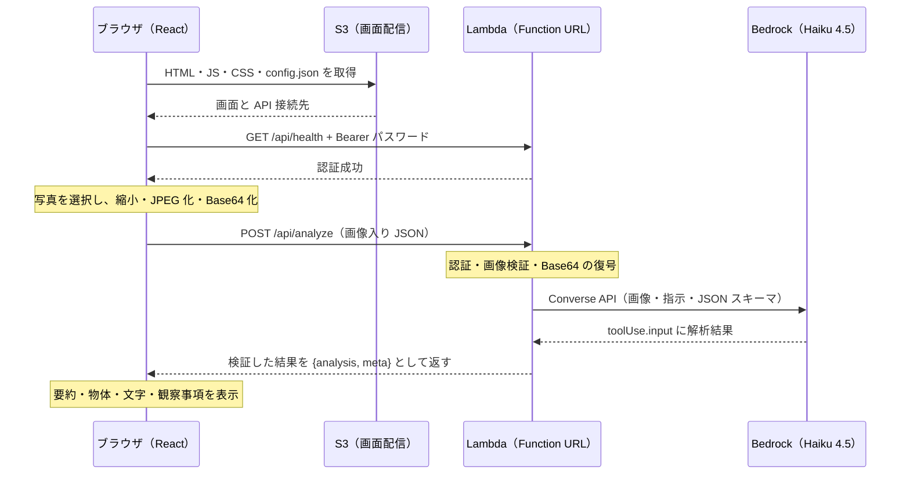

# 写真解析 API の通信仕様

接続先を `<API_BASE_URL>` と表記します。フロントの `public/config.json`、または開発時の `PHOTO_API_PROXY_TARGET` で実際の接続先を指定します。

## 通信フロー



S3 が配信するのは画面のファイルです。写真はブラウザから Lambda へ送ります。
このアプリは写真や解析結果を S3・DB へ保存しません。解析は同期処理で、1回の POST の応答を待ちます。

## 認証と接続確認

```http
GET <API_BASE_URL>/api/health
Authorization: Bearer <テスト用パスワード>
```

成功時は HTTP 200 と `{"status":"ok"}` を返します。
これはパスワードの照合と接続確認です。JWT・Cookie・セッションを発行する処理や、Bedrock の推論は実行しません。
以後の解析リクエストにも同じ Bearer ヘッダーを付けます。
Lambda は受け取ったパスワードの SHA-256 を、環境変数のハッシュと照合します。

## 写真解析

```http
POST <API_BASE_URL>/api/analyze
Authorization: Bearer <テスト用パスワード>
Content-Type: application/json
```

```json
{
  "image": {
    "format": "jpeg",
    "base64": "<JPEG の Base64 文字列>"
  }
}
```

`base64` には `data:image/jpeg;base64,` の接頭辞を付けません。
API は JPEG・PNG・WebP に対応します。付属のフロントは、ブラウザで長辺1600px以下・品質0.85の JPEG に変換してから送ります。

応答例（形式説明用）:

```json
{
  "analysis": {
    "summary": "白いマグカップが写っています。",
    "objects": ["マグカップ"],
    "texts": ["COFFEE"],
    "details": [{"label": "色", "value": "白"}]
  },
  "meta": {
    "elapsed_ms": 2000,
    "request_id": "example-request-id"
  }
}
```

| フィールド | 意味・上限 |
|---|---|
| `analysis.summary` | 写真全体の要約、400文字 |
| `analysis.objects` | 写っているもの、12個・各100文字 |
| `analysis.texts` | 読み取れた文字、20個・各500文字 |
| `analysis.details` | 観察事項、8個・label 40文字・value 300文字 |
| `meta.elapsed_ms` | Bedrock 呼び出し開始から結果の整理までの時間 |
| `meta.request_id` | 調査用の Lambda リクエスト ID |

該当する情報がなければ配列は空です。Lambda は `report_photo` の tool use で返却形式を指定し、受信した `toolUse.input` を検証して返します。外部ツールを実行するコードはありません。

## 制限・エラー・組み込み時の確認

- 1リクエスト1枚です。元画像の選択上限は20 MiB、送信する画像本体は2 MiB、JSON 本文は3 MiBです。
- フロントの解析待機は75秒です。ブラウザが通信を中断しても、開始済みのサーバー処理が停止する保証はありません。
- Lambda の実環境のタイムアウトはインフラ側で設定します。元のテスト環境では60秒です。
- Lambda から Bedrock への認証は IAM ロールが担当します。フロントには AWS アクセスキーを設定しません。
- テスト用パスワードはブラウザのメモリに保持し、リロード時には入力し直します。
- CloudWatch のアプリログには、画像・パスワード・解析結果の本文を記録しません。
- 別ドメイン・別ポートから直接呼ぶ場合は、Function URL の CORS に利用する origin を追加します。開発時に Vite proxy 経由で呼ぶ場合は、ブラウザからは同一 origin の `/api` へアクセスします。
- `frontend/src/api.ts` は接続設定の URL を HTTPS の Lambda Function URL に限定しています。既存の本体バックエンド URL に変更する場合は、この検証と、必要なら認証方法も合わせます。

失敗時は原則として `{"error":"表示用メッセージ", "request_id":"調査用ID"}` を返します。

| HTTP ステータス | 主な意味 |
|---|---|
| `400` | JSON・画像・サイズ等が不正、またはモデルの入力検証エラー |
| `401` | パスワードの不一致・未指定 |
| `404` / `405` | パス・メソッドが対象外 |
| `415` | Content-Type が application/json 以外 |
| `502` | モデルへの接続失敗や、応答形式の不正 |
| `503` | モデルを利用できない、混雑中、または認証設定が未完了 |
